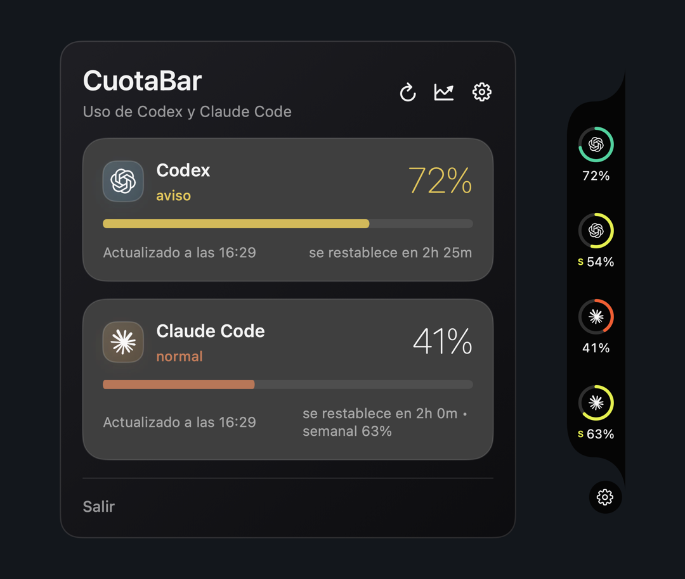

# CuotaBar

[Español](#español) · [English](#english) · [日本語](#日本語)



## Español

CuotaBar muestra cuánto has consumido de tus cuotas de Codex y Claude Code
desde la barra de menús de macOS y en un widget flotante.

### Funciones

- Consulta el porcentaje consumido y cuándo se restablece cada cuota. Activa
  la cuota semanal en el widget para cada servicio.
- Ajusta el tamaño, la posición, la opacidad y el orden de los servicios en el
  widget. Puedes mantenerlo por encima de otras ventanas y elegir entre los
  modos normal y minimalista.
- Actualiza los datos manualmente o a intervalos configurables. Recibe avisos
  al alcanzar el umbral de uso elegido o al restablecerse la cuota.
- Abre **Informe de uso** desde el icono del gráfico en el panel de la barra de
  menús. Consulta los últimos 7 o 30 días y exporta el historial completo en
  CSV o JSON.
- Elige español, inglés o japonés en **Ajustes → Idioma**, o usa el idioma de
  macOS.

### Instalar y conectar

Necesitas macOS 14 o posterior y Swift 6.2 o posterior para compilar la app.

1. Ejecuta este comando desde la carpeta del proyecto.

   ```sh
   ./scripts/build_app.sh
   ```

2. Mueve `dist/v<version>/CuotaBar.app` a **Aplicaciones** y ábrela. El script
   genera una app universal para Apple Silicon e Intel con firma ad hoc por
   defecto para uso local.
3. En CuotaBar, abre **Ajustes → Cuentas** y elige **Conectar** junto al
   servicio que quieras monitorizar.

**Codex.** Si CuotaBar no encuentra una sesión, inicia sesión en la app de
Codex o en la CLI y vuelve a pulsar **Conectar**. CuotaBar usa la sesión
guardada en `~/.codex/auth.json`.

**Claude Code.** CuotaBar puede usar una sesión iniciada en la app de
escritorio de Claude o en Chrome, Brave, Edge, Arc, Chromium o Safari. Si no
encuentra una sesión, abre el navegador predeterminado para que inicies sesión
en claude.ai. Vuelve a CuotaBar y pulsa **Conectar** de nuevo.

Para usar una sesión de Safari, concede a CuotaBar acceso total al disco desde
**Ajustes del Sistema → Privacidad y seguridad → Acceso total al disco**. Usa
el mismo ajuste si CuotaBar indica que macOS bloqueó el acceso a la sesión de
otro navegador.

CuotaBar utiliza tu sesión local para consultar los datos de uso del servicio y
conserva hasta 90 días de historial en
`~/Library/Application Support/CuotaBar/usage_history.json`.

### Crear una distribución propia

Para crear un DMG notarizado, define `SIGN_IDENTITY` con tu certificado
Developer ID Application y ejecuta `./scripts/release.sh` con un perfil de
`notarytool` configurado. `KEYCHAIN_PROFILE` selecciona el perfil y su valor
predeterminado es `CuotaBar`. El DMG se genera en
`dist/v<version>/CuotaBar.dmg`. La app y el DMG incluyen la licencia MIT.

Para habilitar las actualizaciones de Sparkle al ejecutar
`./scripts/build_app.sh`, define conjuntamente `UPDATE_FEED_URL` con la URL
HTTPS de tu appcast y `UPDATE_PUBLIC_KEY` con la clave pública EdDSA de Sparkle.
Si ejecutas `./scripts/release.sh` con actualizaciones habilitadas, define
también `GITHUB_RELEASE_BASE` con la URL HTTPS base de descarga y configura la
clave privada correspondiente para firmar la actualización.

## English

CuotaBar shows how much of your Codex and Claude Code quotas you’ve used, both
in the macOS menu bar and in a floating widget.

### Features

- Check the percentage used and when each quota resets. Enable weekly quotas
  in the widget for each service.
- Adjust the widget’s size, position, opacity, and service order. Keep it
  above other windows and choose between normal and minimal display modes.
- Refresh usage manually or at configurable intervals. Get notified when you
  reach your chosen usage threshold or when a quota resets.
- Open **Usage Report** from the chart icon in the menu bar panel. View 7 or
  30 days of history and export all recorded history as CSV or JSON.
- Choose Spanish, English, or Japanese in **Settings → Language**, or follow
  the macOS language.

### Install and connect

You need macOS 14 or later and Swift 6.2 or later to build the app.

1. Run this command from the project folder.

   ```sh
   ./scripts/build_app.sh
   ```

2. Move `dist/v<version>/CuotaBar.app` to **Applications** and open it. The
   script creates a universal app for Apple silicon and Intel with an ad hoc
   signature for local use by default.
3. In CuotaBar, open **Settings → Accounts** and select **Connect** next to
   the service you want to monitor.

**Codex.** If CuotaBar can’t find a session, sign in to the Codex app or CLI
and select **Connect** again. CuotaBar uses the session stored in
`~/.codex/auth.json`.

**Claude Code.** CuotaBar can use a session from the Claude desktop app or
from Chrome, Brave, Edge, Arc, Chromium, or Safari. If it can’t find a session,
it opens your default browser so you can sign in at claude.ai. Return to
CuotaBar and select **Connect** again.

To use a Safari session, grant CuotaBar Full Disk Access in
**System Settings → Privacy & Security → Full Disk Access**. Use the same
setting if CuotaBar reports that macOS blocked access to another browser’s
session.

CuotaBar uses your local session to fetch usage from the service and keeps
up to 90 days of history in
`~/Library/Application Support/CuotaBar/usage_history.json`.

### Build a custom distribution

To create a notarized DMG, set `SIGN_IDENTITY` to your Developer ID
Application certificate and run `./scripts/release.sh` with a configured
`notarytool` profile. Set `KEYCHAIN_PROFILE` to select a profile. The default
is `CuotaBar`. The script creates `dist/v<version>/CuotaBar.dmg`. The app and
the DMG include the MIT license.

To enable Sparkle updates when running `./scripts/build_app.sh`, set both
`UPDATE_FEED_URL` to your HTTPS appcast URL and `UPDATE_PUBLIC_KEY` to your
Sparkle EdDSA public key. If you run `./scripts/release.sh` with updates
enabled, also set `GITHUB_RELEASE_BASE` to your HTTPS release download base
URL and configure the corresponding private key to sign the update.

## 日本語

CuotaBar は、Codex と Claude Code の利用率を macOS のメニューバーと
フローティングウィジェットで確認できるアプリです。

### 主な機能

- 現在の利用率とリセット時刻を確認できます。ウィジェットにはサービスごとに
  週間利用枠も表示できます。
- ウィジェットのサイズ、位置、不透明度、サービスの表示順を調整できます。
  常に手前に表示でき、通常モードとミニマルモードを切り替えられます。
- 手動または指定した間隔で利用率を更新できます。設定したしきい値に達したときや
  利用枠がリセットされたときに通知を受け取れます。
- メニューバーのパネルにあるグラフのアイコンから **使用量レポート** を開けます。
  直近 7 日間または 30 日間の履歴を確認し、保存済みの全履歴を CSV や JSON で
  書き出せます。
- **設定 → 言語** で日本語、英語、スペイン語を選ぶか、macOS の言語設定に従う
  ことができます。

### インストールと接続

アプリのビルドには macOS 14 以降と Swift 6.2 以降が必要です。

1. プロジェクトのフォルダで次のコマンドを実行します。

   ```sh
   ./scripts/build_app.sh
   ```

2. `dist/v<version>/CuotaBar.app` を **アプリケーション** フォルダに移動し、
   開きます。Apple シリコンと Intel に対応したローカル利用向けの
   ユニバーサルアプリが作成され、既定でアドホック署名が適用されます。
3. CuotaBar の **設定 → アカウント** を開き、利用率を確認したいサービスの
   **接続** を選びます。

**Codex** のセッションが見つからない場合は、Codex アプリまたは CLI に
ログインしてから、もう一度 **接続** を選びます。CuotaBar は
`~/.codex/auth.json` に保存されたセッションを使います。

**Claude Code** は、Claude のデスクトップアプリ、または Chrome、Brave、Edge、
Arc、Chromium、Safari のログインセッションを利用できます。セッションが
見つからない場合は、既定のブラウザが開きます。claude.ai にログインし、
CuotaBar に戻ってもう一度 **接続** を選びます。

Safari のセッションを使う場合は、
**システム設定 → プライバシーとセキュリティ → フルディスクアクセス** で
CuotaBar に許可を与えます。他のブラウザのセッションへのアクセスが macOS に
よって拒否された場合も、同じ設定を使います。

CuotaBar はローカルのログインセッションを使って各サービスから利用率を取得し、
最大 90 日間の履歴を
`~/Library/Application Support/CuotaBar/usage_history.json` に保存します。

### 配布用ビルド

公証済みの DMG を作成するには、`SIGN_IDENTITY` に Developer ID Application
証明書を指定し、設定済みの `notarytool` プロファイルで
`./scripts/release.sh` を実行します。`KEYCHAIN_PROFILE` でプロファイルを指定
でき、既定値は `CuotaBar` です。出力先は `dist/v<version>/CuotaBar.dmg` です。
アプリと DMG には MIT ライセンスが同梱されます。

`./scripts/build_app.sh` の実行時に Sparkle のアップデートを有効にするには、
`UPDATE_FEED_URL` に HTTPS の appcast URL を、`UPDATE_PUBLIC_KEY` に Sparkle の
EdDSA 公開鍵を設定します。アップデートを有効にして `./scripts/release.sh` を
実行する場合は、`GITHUB_RELEASE_BASE` に配布ファイルのダウンロード先となる
HTTPS のベース URL を設定し、対応する秘密鍵で署名できるようにします。

## Licencia / License / ライセンス

[MIT License](LICENSE) · Fork de / Fork of / フォーク元
[LimitBar](https://github.com/tako3ch/LimitBar) · © 2026 TakumiKato
